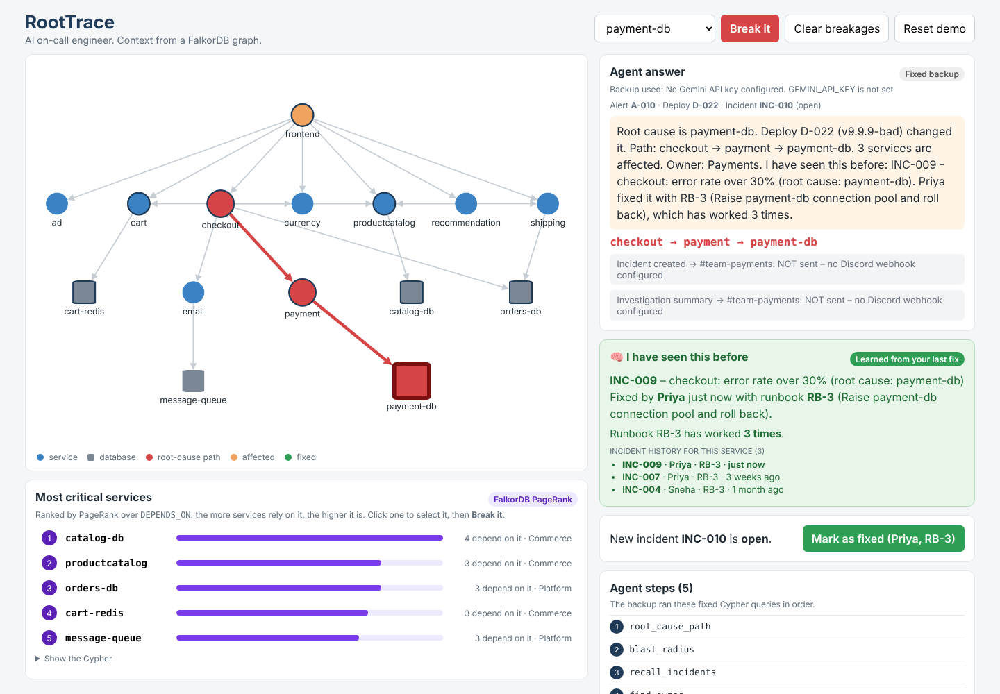
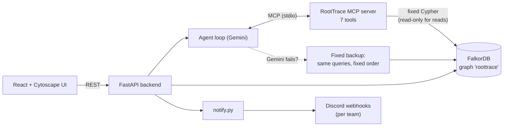
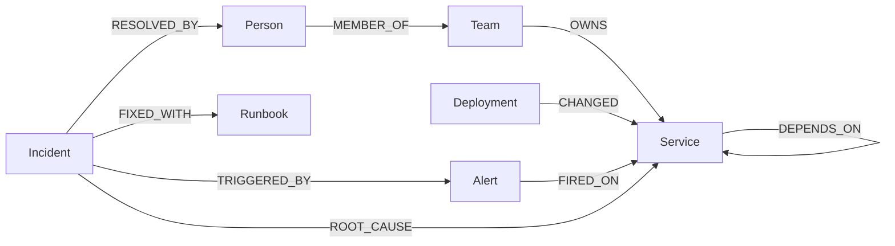

# RootTrace — an AI on-call engineer with graph memory

**When a service breaks, RootTrace follows the dependency graph in FalkorDB to find the real cause,
tells the owner team, and remembers the fix for next time.**

> **Hackathon:** Graph Hacks: Context for AI Agents (WeMakeDevs × FalkorDB), 15–18 Oct 2026
> **Tracks:** 01 Agents That Act on Connected Data · 02 Agent Memory and Coordination
> **Live demo:** https://ai-on-call-engineer.vercel.app · **API:** https://ai-on-call-engineer.onrender.com/docs · **Demo video:** https://youtu.be/sLNPF1JlorE
>
> _The free backend sleeps when idle: the first click can take up to a minute. If the live site is down, see [Run it locally](#run-it-locally) or the demo video._



---

## The problem

When something breaks in a microservice system, the alert usually fires **far from the cause**.
Checkout shows errors, but the real problem is a bad deploy on a database three hops away.
The on-call engineer has to answer, at 3 AM:

1. What actually broke, and what changed?
2. What else is affected?
3. Who owns it?
4. **Have we seen this before, and how did we fix it last time?**

Every one of these is a question about **connections**. That is why RootTrace keeps its context in a graph.

## What RootTrace does

1. **An alert fires** (in the demo: click **Break it** on a service, e.g. `payment-db`).
   RootTrace creates a bad deploy on that service and an alert on a service upstream (`checkout`).
2. **The agent investigates.** Gemini chooses tools from our **MCP server**. Each tool runs a fixed,
   tested Cypher query in FalkorDB:
   - follow `DEPENDS_ON` from the alerting service down to the deepest service with a recent deploy,
   - measure the blast radius,
   - recall past incidents on that service,
   - find the owner team.
3. **It shows its work.** The path lights up red on the map. Every step shows the tool, its inputs,
   the exact Cypher, and the result.
4. **It acts.** It saves a new `Incident` node in the graph and posts to the owner team's Discord channel.
5. **It remembers.** Click **Mark as fixed** and the fix is stored as graph relationships
   (`FIXED_WITH` a runbook, `RESOLVED_BY` a person). Break the same service again and the agent says:
   *"I have seen this before: INC-009, fixed by Priya with RB-3. That runbook has worked 3 times."*

The agent **never writes Cypher itself**. It only picks which tested query to run.
Every fact in its answer must come from a tool result; answers with invented IDs are flagged.

---

## Architecture



| Part | File | What it does |
|---|---|---|
| Graph layer | `backend/graph.py` | FalkorDB connection and **all** Cypher queries. Reads use `ro_query` (read-only). |
| MCP server | `backend/tools.py` | 7 tools that wrap `graph.py`. Any MCP client can use them. |
| Agent | `backend/agent.py` | Starts the MCP server, gives its tools to Gemini, runs the tool loop, checks grounding. Falls back to a fixed investigation if Gemini fails. |
| API | `backend/api.py` | REST endpoints for the UI (see [docs/api.md](docs/api.md)). |
| Notifications | `backend/notify.py` | Posts to Discord **after** the database change succeeds. Honest delivery status. |
| Seed data | `data/*.json`, `backend/seed.py` | A synthetic online shop. Safe to reload. |
| UI | `frontend/src/` | Service map, red/green path, agent steps, memory card, PageRank panel. |

### MCP tools

| Tool | Type | Graph work |
|---|---|---|
| `root_cause_path` | read | Multi-hop walk down `DEPENDS_ON` to a recent, not rolled-back deploy |
| `blast_radius` | read | Multi-hop walk up `DEPENDS_ON` (1–5 hops) |
| `recall_incidents` | read | Past resolved incidents, runbook and who fixed it (**memory**) |
| `find_owner` | read | `Service ← OWNS ← Team ← MEMBER_OF ← Person` |
| `critical_services` | read | **PageRank** over `DEPENDS_ON` |
| `save_incident` | action | Writes an `Incident` linked to the alert and root cause |
| `notify_team` | action | Attaches a message for the owner team; RootTrace posts it to Discord |

---

## Graph data model

Direction rule: `checkout -[:DEPENDS_ON]-> payment` means **checkout needs payment**.
If payment breaks, checkout breaks.



### Nodes
| Label | Key properties |
|---|---|
| `Service` | `name`, `kind` (service / database), `tier` (1 = critical) |
| `Team` | `name`, `discord_channel` |
| `Person` | `name`, `email` |
| `Deployment` | `id`, `version`, `author`, `at`, `rolled_back` |
| `Alert` | `id`, `message`, `severity`, `at` |
| `Incident` | `id`, `title`, `status` (open / resolved / cancelled), `started_at`, `resolved_at`, `runbook_id`, `resolved_by` |
| `Runbook` | `id`, `title`, `steps`, `success_count` |

### Relationships
| Relationship | Meaning |
|---|---|
| `(Person)-[:MEMBER_OF]->(Team)` | Person works in this team |
| `(Team)-[:OWNS]->(Service)` | Team is responsible for this service |
| `(Service)-[:DEPENDS_ON]->(Service)` | A needs B |
| `(Deployment)-[:CHANGED]->(Service)` | This deploy changed this service |
| `(Alert)-[:FIRED_ON]->(Service)` | The alert came from this service |
| `(Incident)-[:TRIGGERED_BY]->(Alert)` | The incident started from this alert |
| `(Incident)-[:ROOT_CAUSE]->(Service)` | The real broken service |
| `(Incident)-[:FIXED_WITH]->(Runbook)` | This runbook fixed it |
| `(Incident)-[:RESOLVED_BY]->(Person)` | This person fixed it |

**Demo data (synthetic):** 15 services, 5 teams, 12 people, 20 deployments, 8 past incidents, 6 runbooks.
No real or personal data is used.

---

## The Cypher the product depends on

All queries live in [`backend/graph.py`](backend/graph.py).

**1. Root-cause path:** from the alerting service, walk down to the deepest dependency with a recent deploy
that has not been rolled back. Returns the full path for the UI.
```cypher
MATCH p = (start:Service {name: $name})-[:DEPENDS_ON*0..5]->(suspect:Service)
MATCH (d:Deployment)-[:CHANGED]->(suspect)
WHERE d.at >= $since AND d.at <= $until AND coalesce(d.rolled_back, false) = false
WITH p, suspect, d, length(p) AS hops
ORDER BY d.at DESC, hops DESC
LIMIT 1
RETURN [n IN nodes(p) | n.name] AS path,
       suspect.name AS root_cause,
       d.id AS deployment, d.version AS version, d.author AS author, d.at AS at
```

**2. Blast radius:** what breaks if this service goes down?
```cypher
MATCH (broken:Service {name: $name})<-[:DEPENDS_ON*1..5]-(affected:Service)
RETURN DISTINCT affected.name AS service, affected.tier AS tier
ORDER BY tier, service
```

**3. Memory:** have we seen this before? Who fixed it, and how?
```cypher
MATCH (i:Incident {status: 'resolved'})-[:ROOT_CAUSE]->(:Service {name: $name})
OPTIONAL MATCH (i)-[:FIXED_WITH]->(r:Runbook)
OPTIONAL MATCH (i)-[:RESOLVED_BY]->(p:Person)
RETURN i.id AS incident, i.title AS title, i.resolved_at AS resolved_at,
       r.id AS runbook, r.title AS runbook_title, r.success_count AS runbook_wins,
       p.name AS fixed_by
ORDER BY resolved_at DESC
```

**4. Critical services (graph algorithm):** PageRank over `DEPENDS_ON`, plus how many services depend on each.
```cypher
CALL algo.pageRank('Service', 'DEPENDS_ON') YIELD node, score
WITH node, score ORDER BY score DESC LIMIT $limit
OPTIONAL MATCH (node)<-[:DEPENDS_ON*1..5]-(up:Service)
WITH node, score, count(DISTINCT up) AS dependents
OPTIONAL MATCH (t:Team)-[:OWNS]->(node)
RETURN node.name AS service, node.kind AS kind, score, dependents, t.name AS team
ORDER BY score DESC
```

**5. Owner:** who owns it, and where do we message them?
```cypher
MATCH (s:Service {name: $name})<-[:OWNS]-(t:Team)
OPTIONAL MATCH (p:Person)-[:MEMBER_OF]->(t)
RETURN t.name AS team, t.discord_channel AS channel, collect(p.name) AS people
```

When an incident is resolved, RootTrace links it with `FIXED_WITH` and `RESOLVED_BY`, marks the bad
deploy `rolled_back`, and **recounts** the runbook's `success_count` from stored resolved incidents,
so a fix can never be counted twice.

---

## How it maps to the tracks

### Track 01: Agents That Act on Connected Data
| Key focus | Where it is in RootTrace |
|---|---|
| Multi-hop reasoning | `root_cause_path` (`*0..5`) and `blast_radius` (`*1..5`) walk the dependency graph |
| Graph queries and algorithms as agent tools | 7 tools wrap fixed Cypher, including **PageRank** (`critical_services`) |
| Tool selection through MCP | `tools.py` is an MCP server; Gemini picks tools from its live tool list |
| Actions based on what the graph shows | Saves an `Incident` node; posts to the **owner team's** Discord channel |
| Explainable results | Red path on the map; every step shows tool, inputs, Cypher and result; ungrounded IDs are flagged |

### Track 02: Agent Memory and Coordination
| Key focus | Where it is in RootTrace |
|---|---|
| Episodic memory | Every incident is a node: what broke, when, which alert, which deploy |
| Semantic memory | The service map, owners and teams in the graph |
| Procedural memory | `FIXED_WITH` runbooks and their `success_count` ("worked 3 times") |
| Persistent history | Memory lives in FalkorDB, not in the model. It survives restarts and is used on the next incident |
| Shared state and handoffs | The graph is the shared state between the agent (through the MCP server process), the API and the human, who hands off with **Mark as fixed** |
| Safe concurrent writes | One incident per alert even if investigation is retried; resolving twice changes nothing; a conflicting resolve returns 409 |
| Separate memory per tenant | The graph name is configurable (`ROOTTRACE_GRAPH`). Tests run on their own graph (`roottrace_test`) in the same FalkorDB instance, the same way each tenant would get its own graph |

---

## Run it locally

**You need:** Docker Desktop, Python 3.11+, Node.js 18+, and a Gemini API key.
Without a Gemini key, RootTrace still works in **fixed backup** mode.

### 1. Start FalkorDB
```bash
docker compose up -d
```
FalkorDB Browser: http://localhost:3000

### 2. Configure
Copy `.env.example` to `.env` in the project root and fill in:

| Variable | Needed? | What |
|---|---|---|
| `GEMINI_API_KEY` | Recommended | Gemini key. Without it, the fixed backup runs. |
| `GEMINI_MODEL` | Optional | Default `gemini-3.8-flash` |
| `FALKORDB_HOST`, `FALKORDB_PORT`, `FALKORDB_PASSWORD` | Optional | Default `localhost:6379`, no password |
| `DISCORD_WEBHOOK_URL` | Optional | Default Discord webhook |
| `DISCORD_WEBHOOK_<TEAM>` | Optional | Per-team webhook, e.g. `DISCORD_WEBHOOK_PAYMENTS` |

Never commit `.env`. Check your Discord setup with `python discord_check.py` (in `backend/`).

### 3. Backend
```bash
cd backend
python -m venv .venv
.venv\Scripts\activate            # Mac/Linux: source .venv/bin/activate
pip install -r requirements.txt
python seed.py                    # load the demo graph (also done automatically if empty)
uvicorn api:app --reload --port 8000
```
API docs: http://localhost:8000/docs

### 4. Frontend
```bash
cd frontend
npm install
npm run dev
```
Open http://localhost:5173

### 5. Try the demo
1. Pick `payment-db` and click **Break it**. Watch the red path and the agent steps.
2. Click **Mark as fixed**. The path turns green and the fix is saved to the graph.
3. Click **Break it again**. The agent remembers the fix you just made.
4. **Clear breakages** undoes open breakages but keeps memory. **Reset demo** reloads clean data.

### Tests
```bash
cd backend && python -m pytest -v     # needs FalkorDB running; uses a separate graph 'roottrace_test'
cd frontend && npm test
```
Gemini and Discord are always faked in tests. Your demo graph is never touched.

---

## API

| Method | Path | What |
|---|---|---|
| GET | `/graph` | Service map for the UI |
| POST | `/break` | Simulate an outage: bad deploy + alert upstream |
| POST | `/investigate` | Run the agent on an alert |
| POST | `/resolve` | Save the fix as memory |
| POST | `/clear` | Undo open breakages, keep memory |
| POST | `/reset` | Reload clean demo data |
| GET | `/critical-services` | PageRank ranking |
| GET | `/incidents/{id}` | One incident as stored |
| GET | `/notifications` | Recent Discord messages and their delivery status |

Full request and response examples: [docs/api.md](docs/api.md).

---

## Design decisions

- **Fixed queries, not text-to-Cypher.** The LLM picks tools; it never writes Cypher. Each query is tested,
  so a wrong answer can only come from the wrong tool choice, which is visible in the steps.
- **Read-only by default.** Read tools use `ro_query`. The only writes are saving an incident and resolving one.
  The agent never restarts, rolls back or deletes anything; it only recommends.
- **Grounding check.** IDs in the final answer must appear in a tool result; otherwise they are flagged.
- **Always a working demo.** If Gemini fails (rate limit, timeout, auth, bad answer), the same queries run
  in a fixed order and the UI says so (`mode: fixed` + reason).
- **Honest notifications.** Discord messages are sent only after the database change succeeds, and the
  status is `sent` only when Discord confirms it.

## Real-world use and limits

In production, each demo input is replaced by a live feed. The graph model, queries and agent stay the same.

| Demo | Real world |
|---|---|
| **Break it** button | Monitoring (e.g. Prometheus Alertmanager, Grafana) sends alerts to a webhook |
| `services.json` | Service map built from Kubernetes or tracing data |
| `deployments.json` | The CI/CD pipeline reports each deploy |
| `teams.json`, `people.json` | A service catalog or `CODEOWNERS` |
| Discord | Slack, Teams or PagerDuty |

**Known limits:**
- "Recently deployed" is a strong signal, not proof. The agent suggests; a human confirms with **Mark as fixed**.
- The graph must be kept current; in production it would be synced automatically.
- One failure can trigger many alerts; grouping them into one incident is future work.
- One agent today. A planned next step is separate Triage, Investigator and Comms agents sharing the Incident node.

---

## AI tools used (disclosure)

As the rules require, we disclose our use of AI coding assistants.

- **Claude (Anthropic)** helped with planning, the starter code (seed data, Cypher queries, MCP tools,
  the Gemini agent loop, UI components) and this README.
- No other AI coding assistants were used.

Every change was reviewed, run and tested by the team. We can explain the graph model, every query,
the agent loop and the architecture.

**Team:** Ajiththeerthiya R · Karishma R · **License / IP:** owned by the team.
