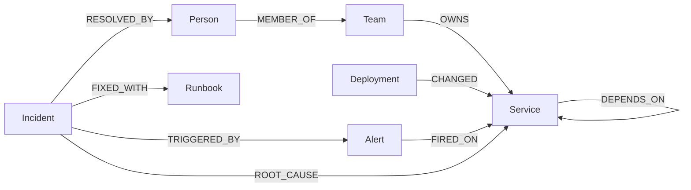

# RootTrace

An AI on-call engineer. When a service breaks, the agent follows the
dependency graph in FalkorDB to find the root cause, tells the owner, and
remembers the fix for next time.

**Tracks:** Agents That Act on Connected Data, Agent Memory and Coordination

## Run it locally

### 1. Start FalkorDB
```bash
docker compose up -d
```
FalkorDB Browser: http://localhost:3000

### 2. Backend
```bash
cd backend
python -m venv .venv
.venv\Scripts\activate          # Mac/Linux: source .venv/bin/activate
pip install -r requirements.txt
python test_db.py               # should print [['test']]
uvicorn api:app --reload --port 8000
```
API test page: http://localhost:8000/docs

Copy `.env.example` to `.env` and add your Gemini key. Never commit `.env`.

### 3. Frontend
```bash
cd frontend
npm install
npm run dev
```
Open http://localhost:5173

## API
See [docs/api.md](docs/api.md).

## Graph Data Model

Direction rule: `checkout DEPENDS_ON payment` means checkout needs payment.
If payment breaks, checkout breaks.

### Nodes
| Label      | Properties                                         |
|------------|----------------------------------------------------|
| Person     | name, email                                        |
| Team       | name, discord_channel                              |
| Service    | name, kind (service or database), tier (1 = critical) |
| Deployment | id, version, author, at (time)                     |
| Alert      | id, message, severity, at                          |
| Incident   | id, title, status (open or resolved), started_at, resolved_at |
| Runbook    | id, title, steps, success_count                    |

### Relationships
| Relationship                          | Meaning                               |
|---------------------------------------|---------------------------------------|
| (Person)-[:MEMBER_OF]->(Team)         | Person works in this team             |
| (Team)-[:OWNS]->(Service)             | Team is responsible for this service  |
| (Service)-[:DEPENDS_ON]->(Service)    | A needs B. If B breaks, A breaks.     |
| (Deployment)-[:CHANGED]->(Service)    | This deploy changed this service      |
| (Alert)-[:FIRED_ON]->(Service)        | Alert came from this service          |
| (Incident)-[:TRIGGERED_BY]->(Alert)   | Incident started from this alert      |
| (Incident)-[:ROOT_CAUSE]->(Service)   | The real broken service               |
| (Incident)-[:FIXED_WITH]->(Runbook)   | This runbook fixed it                 |
| (Incident)-[:RESOLVED_BY]->(Person)   | This person fixed it                  |



## Cypher queries
_To be added: blast radius, root-cause path, recall past incidents, PageRank._

## AI tools used
_To be filled in: which AI coding assistants we used and for what._
